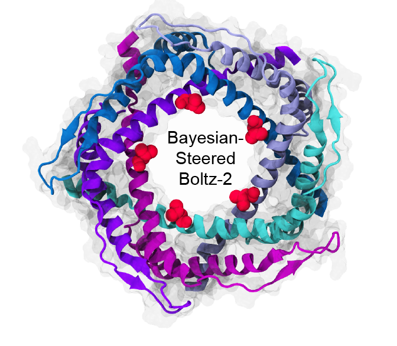
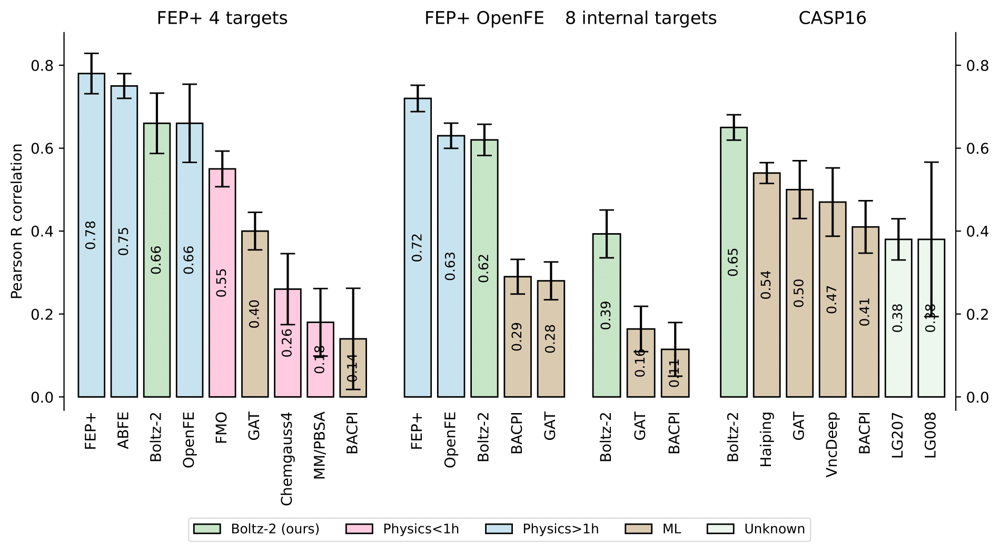
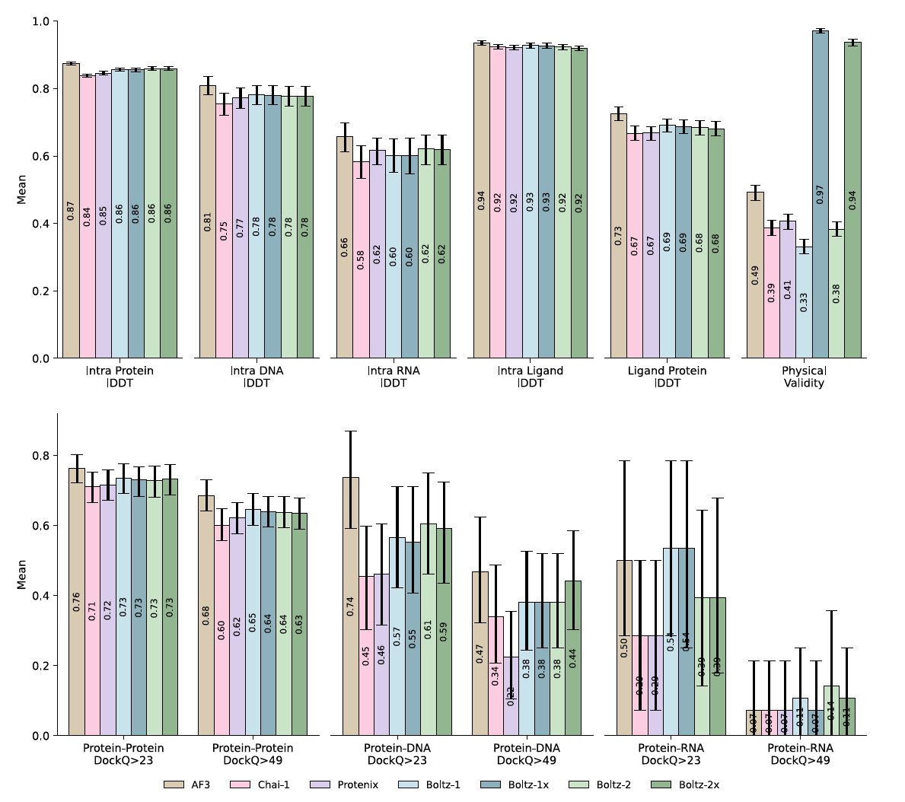

<div align="center">
  <div>&nbsp;</div>
  
</div>

## Branch `cg-potential`: coarse-grained backmapping (waltmann1 fork)
This branch of the fork adds coarse-grained (CG) backmapping on top of the Bayesian-steered Boltz-2 code below: given CG bead positions, sample all-atom structures whose beads match them. It is the Boltz-2 engine for a future `msback2` (a pure-Python repo, successor to MSBack, which uses Chroma). Work in progress; stock Boltz behaviour is unchanged.

- `src/boltz/colvars/cg_potential.py`: `CGMap`/`CGBead` (a bead is a weighted set of atoms identified by chain, residue position, atom name; a Cα preset is included) and `CGPotential`, a Gaussian likelihood (harmonic when `allowed=0`, width `sigma`, default 1 Å) on bead positions after rigid alignment of the target onto the sample.
- `src/boltz/colvars/cg_sample.py`: `CGSampler` / `cg_sample()`, a pure-Python entry point (no CLI) that runs steered sampling and exposes `sigma`, `allowed`, particle and resampling settings and the diffusion hyperparameters.
- `src/boltz/colvars/cg_loaders.py`: reads OpenMSCG/mstool map YAMLs and builds a Boltz input from a PDB. File formats are kept out of `CGPotential`.
- Only edit to existing code: `diffusionv2.py` accepts `steering_args["potentials"]`, otherwise it falls back to `get_potentials`.
- `tests/test_cg_potential.py` (no GPU needed), `cg_tests/mprotein/` (M-protein homodimer example).
- `cluster/`: reproducible install and job scripts for the Beagle3 cluster, see [`cluster/README.md`](cluster/README.md).

Known limits: very tight `sigma` (below about 0.75 Å) can make guidance diverge, with no guard yet. Only protein chains are supported by the loaders so far. See the upstream section below for the Bayesian-steering framework this builds on.

## Running Boltz-2 conditional on arbitrary Bayesian likelihoods
We have implemented an interface that allows users to condition protein structure predictions on arbitrary constraints within Boltz-2. To do this, we adopt a Bayesian framework where the Boltz-2 foundation model is treated as a prior. The user then designs a likelihood function which expresses some relation between the atomic coordinates of the structure and the desired constraint or property. With this input, our modified form of Boltz-2 will run twisted diffusion to draw samples from the posterior distribution. If you use this code for your applications, please cite our paper [Bayesian-Steered Structure Prediction of Mechanical Biomoleculues Using Twisted Diffusion](https://www.biorxiv.org/cgi/content/short/2026.05.11.724187v1).

```bibtex
@article{Klaus2026.05.11.724187,
  title={Bayesian-Steered Structure Prediction of Mechanical Biomolecules Using Twisted Diffusion},
  author={Klaus, Colin and Sotomayor, Marcos},
  journal={bioRxiv},
  year={2026},
}
```

To install our version of Boltz-2, we recommend creating and activating a fresh python environment, then running
```
conda install python=3.11 pip jupyterlab
pip install mdanalysis
pip install -e .[cuda]
```
which will install the packages needed to run Boltz-2 in editable mode so that the software reads updates to the Bayesian-steering likelihood. Jupyterlab is used to run an auxilliary notebook we have created for extracting atom indices, and mdanalysis is used by `src/boltz/colvars/mdanalysis_writedcd.py` to convert the pdb files that are optionally generated along diffusion trajectories into a dcd trajectory.

To design a custom Bayesian-steering likelihood, users will first need to extract the indices for the atoms in selections that are subject to the constraints. We have created a Jupyter notebook `src/boltz/Boltz2AtomsIds.ipynb` for this purpose. In the first section of the notebook, the user only needs to specify the file paths to the sequence file, given as either a fasta or yaml, and the path to an output directory that should match the output directory Boltz-2 creates at runtime with these inputs. It is recommended that this directory should not exist already when running this notebook. Upon running, the jupyter notebook will recreate Boltz-2's internal representation of the residues specified by the atom indices which belong to them. These lists may be used to extract the relevant atom indices that are needed to define the constraints. In the second section of the notebook, a `connected_atom_index.pt` file is generated in the Boltz-2 home directory. The user only needs to specify the first residue index of each chain in the appropriate notebook cell to correctly generate this file, although if ligands are also present users should make sure that these are not included in the index range used for generation of the `pt` file. The notebook creates a pytorch tensor which records C-N bonded atoms along the backbone. That section may also be modified by a user to instead create a pytorch tensor with the 3' oxygen and the 5' phosphate atoms forming the DNA phosphodiester bond, for example, or any other list of indices desired for an application. At runtime during diffusion these bonds are included into the `connected_atom_index` used by Boltz-2's `ConnectionsPotential` class when the `--use_potentials` flag is passed at the command line to enforce that these atoms should not be unphysically far apart.

Next users will need to define the Bayesian-steering likelihood analytically. For this purpose, we have created a `src/boltz/colvars/colvars.py` file. Inside that file there is a `BayesianPotential` class. Users should modify the function body of the `compute_variable` method to define the function of the atomic coordinates which is being constrained. For example, this function could be a distance between the centers of mass of two atom selections. The actual likelihood function is then defined in the function body of the `compute_function` method. The output of `compute_variable` is available to `compute_function` as its first passed argument. It is important to note that one does not enter the likelihood directly, but instead enters the negative log of the likelihood function as this is more consistent with a potential energy which is what Boltz-2 expects for subclasses of its `Potential` class. In more formal notation, the `compute_function` method should compute `-ln p(xi0|x0)`, where `x0` is the atomic coordinates `coords` variable and `xi0` is the observed variable in the likelihood used to condition the posterior. For example, if `xi` is normally distributed about some function of the coordinates `f(x0)`, then this potential becomes a harmonic restraint upon `f(x0)` with a center given by `xi0`.

> Note: at the present, we do not recommend running affinity predictions in tandem with colvar biasing. The compatibility of these features will be investigated in future releases.

The remaining sections that follow are instructions from the original Boltz-2 repository before we added conditioning by arbitrary Bayesian likelihoods.

<div align="center">
<br>

[Boltz-1](https://doi.org/10.1101/2024.11.19.624167) | [Boltz-2](https://doi.org/10.1101/2025.06.14.659707) |
[Slack](https://boltz.bio/join-slack) <br> <br>
</div>

## Introduction

Boltz is a family of models for biomolecular interaction prediction. Boltz-1 was the first fully open source model to approach AlphaFold3 accuracy. Our latest work Boltz-2 is a new biomolecular foundation model that goes beyond AlphaFold3 and Boltz-1 by jointly modeling complex structures and binding affinities, a critical component towards accurate molecular design. Boltz-2 is the first deep learning model to approach the accuracy of physics-based free-energy perturbation (FEP) methods, while running 1000x faster — making accurate in silico screening practical for early-stage drug discovery.

All the code and weights are provided under MIT license, making them freely available for both academic and commercial uses. For more information about the model, see the [Boltz-1](https://doi.org/10.1101/2024.11.19.624167) and [Boltz-2](https://doi.org/10.1101/2025.06.14.659707) technical reports. To discuss updates, tools and applications join our [Slack channel](https://boltz.bio/join-slack).

## Installation

> Note: we recommend installing boltz in a fresh python environment

Install boltz with PyPI (recommended):

```
pip install boltz[cuda] -U
```

or directly from GitHub for daily updates:

```
git clone https://github.com/jwohlwend/boltz.git
cd boltz; pip install -e .[cuda]
```

If you are installing on CPU-only or non-CUDA GPus hardware, remove `[cuda]` from the above commands. Note that the CPU version is significantly slower than the GPU version.

## Inference

You can run inference using Boltz with:

```
boltz predict input_path --use_msa_server
```

`input_path` should point to a YAML file, or a directory of YAML files for batched processing, describing the biomolecules you want to model and the properties you want to predict (e.g. affinity). To see all available options: `boltz predict --help` and for more information on these input formats, see our [prediction instructions](docs/prediction.md). By default, the `boltz` command will run the latest version of the model.


### Binding Affinity Prediction
There are two main predictions in the affinity output: `affinity_pred_value` and `affinity_probability_binary`. They are trained on largely different datasets, with different supervisions, and should be used in different contexts. The `affinity_probability_binary` field should be used to detect binders from decoys, for example in a hit-discovery stage. It's value ranges from 0 to 1 and represents the predicted probability that the ligand is a binder. The `affinity_pred_value` aims to measure the specific affinity of different binders and how this changes with small modifications of the molecule. This should be used in ligand optimization stages such as hit-to-lead and lead-optimization. It reports a binding affinity value as `log(IC50)`, derived from an `IC50` measured in `μM`. More details on how to run affinity predictions and parse the output can be found in our [prediction instructions](docs/prediction.md).

## Authentication to MSA Server

When using the `--use_msa_server` option with a server that requires authentication, you can provide credentials in one of two ways. More information is available in our [prediction instructions](docs/prediction.md).
 
## Evaluation

⚠️ **Coming soon: updated evaluation code for Boltz-2!**

To encourage reproducibility and facilitate comparison with other models, on top of the existing Boltz-1 evaluation pipeline, we will soon provide the evaluation scripts and structural predictions for Boltz-2, Boltz-1, Chai-1 and AlphaFold3 on our test benchmark dataset, and our affinity predictions on the FEP+ benchmark, CASP16 and our MF-PCBA test set.





## Training

⚠️ **Coming soon: updated training code for Boltz-2!**

If you're interested in retraining the model, currently for Boltz-1 but soon for Boltz-2, see our [training instructions](docs/training.md).


## Contributing

We welcome external contributions and are eager to engage with the community. Connect with us on our [Slack channel](https://boltz.bio/join-slack) to discuss advancements, share insights, and foster collaboration around Boltz-2.

On recent NVIDIA GPUs, Boltz leverages the acceleration provided by [NVIDIA  cuEquivariance](https://developer.nvidia.com/cuequivariance) kernels. Boltz also runs on Tenstorrent hardware thanks to a [fork](https://github.com/moritztng/tt-boltz) by Moritz Thüning.

## License

Our model and code are released under MIT License, and can be freely used for both academic and commercial purposes.


## Cite

If you use this code or the models in your research, please cite the following papers:

```bibtex
@article{passaro2025boltz2,
  author = {Passaro, Saro and Corso, Gabriele and Wohlwend, Jeremy and Reveiz, Mateo and Thaler, Stephan and Somnath, Vignesh Ram and Getz, Noah and Portnoi, Tally and Roy, Julien and Stark, Hannes and Kwabi-Addo, David and Beaini, Dominique and Jaakkola, Tommi and Barzilay, Regina},
  title = {Boltz-2: Towards Accurate and Efficient Binding Affinity Prediction},
  year = {2025},
  doi = {10.1101/2025.06.14.659707},
  journal = {bioRxiv}
}

@article{wohlwend2024boltz1,
  author = {Wohlwend, Jeremy and Corso, Gabriele and Passaro, Saro and Getz, Noah and Reveiz, Mateo and Leidal, Ken and Swiderski, Wojtek and Atkinson, Liam and Portnoi, Tally and Chinn, Itamar and Silterra, Jacob and Jaakkola, Tommi and Barzilay, Regina},
  title = {Boltz-1: Democratizing Biomolecular Interaction Modeling},
  year = {2024},
  doi = {10.1101/2024.11.19.624167},
  journal = {bioRxiv}
}
```

In addition if you use the automatic MSA generation, please cite:

```bibtex
@article{mirdita2022colabfold,
  title={ColabFold: making protein folding accessible to all},
  author={Mirdita, Milot and Sch{\"u}tze, Konstantin and Moriwaki, Yoshitaka and Heo, Lim and Ovchinnikov, Sergey and Steinegger, Martin},
  journal={Nature methods},
  year={2022},
}
```
